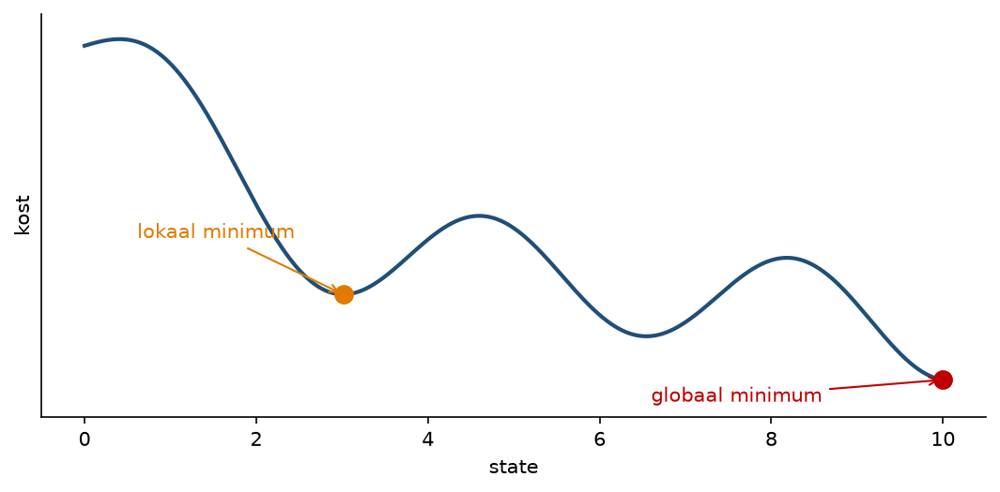
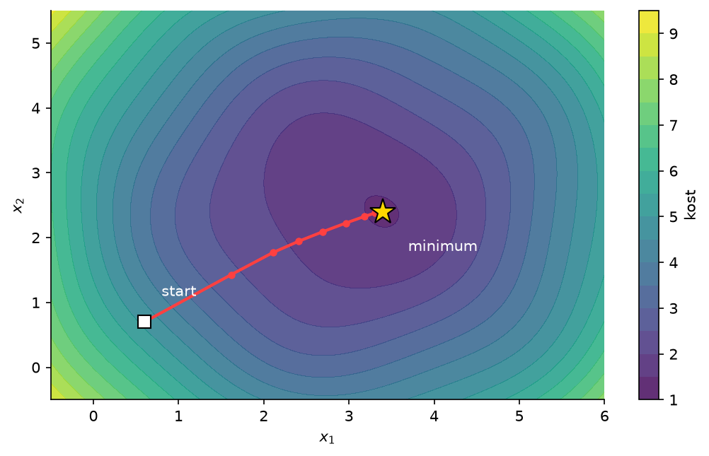
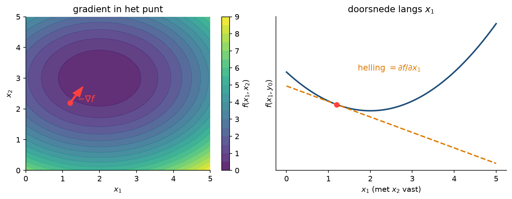
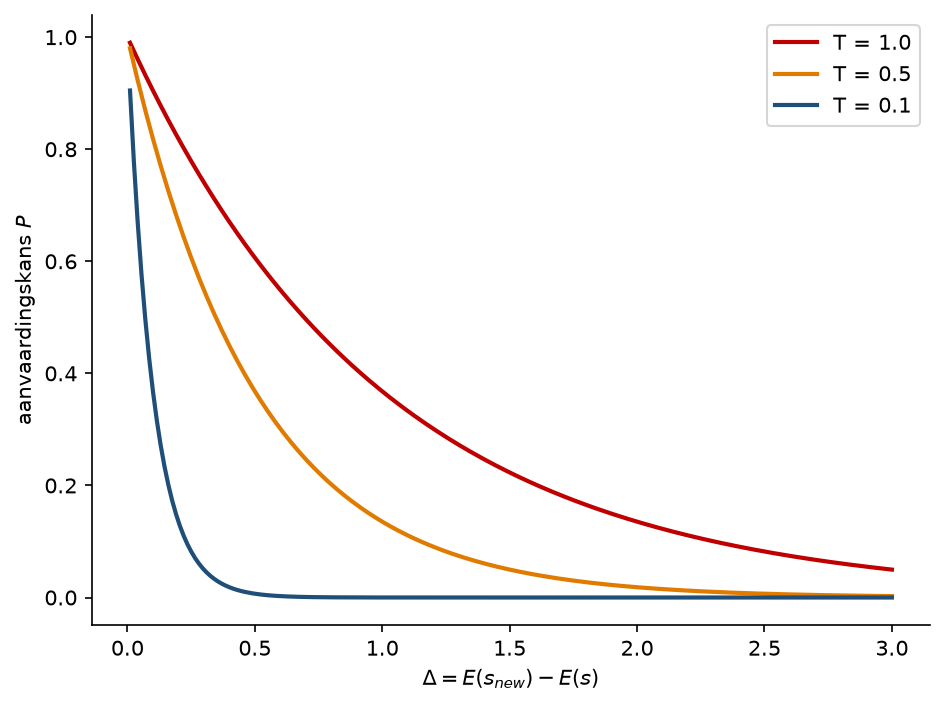

<!-- _class: title-slide -->

# Lokale zoekalgoritmes

## Week 4

---

<!-- _class: red-bg -->

# Iets complexere problemen

---

## Iets complexere problemen

- Tot nu toe: **deterministische, volledig observeerbare** problemen
- Nu breiden we dit lichtjes uit om meer realistische problemen op te lossen
- We kijken naar zoekalgoritmes waarbij enkel de **eindoplossing** telt, niet het pad ernaartoe

---

## Local search

- Gebruikt **minder geheugen**: het slaat geen informatie op
- Is **niet systematisch**
- Vindt vaak een **goede oplossing**, zelfs in grote zoekruimtes
- Risico: vastzitten in een **lokaal minimum**

---

## Local search: kostfunctie



- Voorbeeld: een kostfunctie, we zoeken het punt met minimale kost
- Onderweg liggen obstakels: lokale minima, ridges en plateaus

---

<!-- _class: red-bg -->

# Zoeken en optimaliseren

---

## Verband tussen zoeken en optimaliseren

- Een zoekprobleem kan je vaak **herformuleren** naar een optimalisatieprobleem
- Hiervoor heb je een goede **performance metric** nodig (P uit PEAS), ook wel **kostfunctie** genoemd
- De oplossing van je zoektocht = het **minimaliseren** van die functie

---

## Voorbeeld van kostfuncties

- De meest gebruikte kostfunctie: de **Euclidische afstand**, of het kwadraat ervan

$$\sqrt{\sum_{i=1}^{n}(x_i - y_i)^2}$$

- Niets meer of minder dan de **afstand in vogelvlucht** tussen twee punten
- De vierkantswortel wordt vaak weggelaten om de berekening te versimpelen
- Dit concept komt vaak terug, onder andere in machine learning scoringsmetrieken zoals **Mean Squared Error (MSE)**

---

## Optimalisatie van functies

- Welk algoritme kennen jullie om het minimum van een functie te zoeken?
- Hoe werkt dat algoritme?



---

<!-- _class: red-bg -->

# Gradient descent

---

## Gradient descent

Gradient descent zoekt een minimum door:

1. De **partiële afgeleiden** te berekenen op het huidige punt
2. Een **stap** (met een bepaalde grootte) te zetten in de meest veelbelovende richting
3. Te **stoppen** wanneer er niets meer verandert



- Werkt enkel goed op functies die goed **afleidbaar** zijn
- Risico: in een **lokaal minimum** blijven steken

---

## Gradient descent: implementatie

```python
x = initial_x
converged = False
while not converged:
    y = cost_function(x)
    grad = gradient(x)
    new_x = x - learning_rate * grad
    if np.abs(new_x - x) < convergence_threshold:
        converged = True
    x = new_x
```

---

## Gradient descent: learning rate

- Bij een **te hoge** learning rate spring je over de oplossing
- Een **lagere** learning rate is veiliger, maar duurt langer
- Bovendien kan je nog steeds blijven steken op:
  - Een **plateau**
  - Een **ridge**: een opeenvolging van lokale minima

> Gradient descent is een **greedy algorithm**: het kiest elke stap de op dat moment beste richting

---

## [DEMO] Gradient descent

---

<!-- _class: red-bg -->

# Variaties op gradient descent

---

## Gradient descent variaties

| Variatie | Idee |
|---|---|
| **Stochastic** | Kies een richting, kansverdeling bepaald door de gradiënt |
| **First-choice** | Sample nieuwe vectors tot er een betere richting is |
| **Random restart** | Een paar keer opnieuw proberen |

- Lokale minima blijven een probleem: gradient descent durft niet even "naar boven" gaan alvorens verder af te dalen
- In theorie kan je in willekeurige richtingen wandelen tot je de oplossing vindt, maar dat is héél inefficiënt
- Als oplossing: **simulated annealing**

---

<!-- _class: red-bg -->

# Simulated annealing

---

## Simulated annealing

- Een combinatie van gradient descent en "willekeurige dingen proberen"
- Af en toe **"schudden"** met de situatie, zodat het algoritme naar boven kan
- Hoe verder in het algoritme, hoe **minder hard** we schudden

> "Annealing" is in de metaalbewerking een techniek om metaal op te warmen en af te koelen om het materiaal sterker te maken

---

## Simulated annealing: pseudocode

E is de te minimaliseren functie:

1. Startwaarde $s = s_0$
2. For $k = 0$ tot kmax:
   - $T = temperature(1 - (k+1)/kmax)$
   - $s_{new} \leftarrow valid\_state(s)$
   - Als $E(s_{new}) < E(s)$: $s \leftarrow s_{new}$
   - Else if $P(E(s), E(s_{new}), T) \geq random(0, 1)$: $s \leftarrow s_{new}$
   - Als $E(s_{best}) > E(s)$: $s_{best} \leftarrow s$
3. Output: de finale staat $s$

> We laten "soms" de verkeerde richting toe. Die kans zit in P, en wordt kleiner naarmate de temperatuur T afneemt



---

## Simulated annealing: implementatie

```python
import math
import random

def simulated_annealing(initial_state, cost_function, kmax):
    s = initial_state
    s_best = s

    for k in range(kmax):
        T = max(1 - (k + 1) / kmax, 1e-3)  # temperatuur daalt, maar wordt nooit nul
        s_new = random_neighbor(s)

        if cost_function(s_new) < cost_function(s):
            s = s_new  # altijd beter aanvaarden
        else:
            # Soms slechtere oplossing aanvaarden (kans daalt met T)
            delta = cost_function(s_new) - cost_function(s)
            P = math.exp(-delta / T)
            if random.random() < P:
                s = s_new

        if cost_function(s) < cost_function(s_best):
            s_best = s

    return s_best
```

---

## Simulated annealing: toepassingen

- Het **VLSI layout probleem**: circuits optimaal ordenen op een chip
- Andere vaak gebruikte toepassingen:
  - **Rooster- en planningsproblemen**: examenschema's, personeelsplanning
  - **Routing**: het handelsreizigersprobleem (TSP)
  - **Plaatsing en ontwerp**: pakketten optimaliseren, netwerklay-outs
- steeds hetzelfde patroon: een grote zoekruimte met veel lokale minima, waar exact zoeken te duur is

---

## Simulated annealing: historisch belangrijk

- In de jaren 80 dé techniek om circuits optimaal op borden te ordenen
- Het **Very Large Scale Integration (VLSI) layout probleem** voor integrated circuits (ICs) op een chip
- Heeft bijgedragen aan de chipontwikkeling voor **tientallen jaren**

---

<!-- _class: red-bg -->

# Puzzels en spellen

---

## In puzzels en spellen

- Vaak geen continue, maar een **discrete** functie: een **stapfunctie**
- Gradient descent is dan helaas niet bruikbaar, want deze functies zijn **niet afleidbaar**
- In dat geval neem je van het typisch eindig aantal stappen de **beste optie**
- Hebben we al eens gedaan voor de **schuifpuzzel**

---

## Samenvatting

- Local search: enkel de eindoplossing telt, weinig geheugen, niet systematisch
- Zoekprobleem herformuleren als optimalisatieprobleem met een kostfunctie
- Gradient descent: greedy, stappen in de dalende richting, risico op lokale minima
- Learning rate: afweging tussen snelheid en veiligheid
- Variaties: stochastic, first-choice, random restart
- Simulated annealing: af en toe schudden, kans daalt met de temperatuur
- Discrete functies: gradient descent kan niet, neem de beste optie

---

<!-- _class: red-bg -->

# Vragen?
